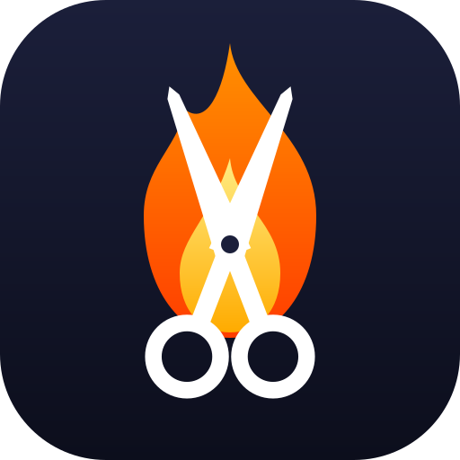

# AUTOCORTES Z

<p align="center"></p>

**por OZBITS** · [Baixar o instalador](https://github.com/OZBITS/autocortes-z/releases/latest)

Corta vídeo e live da **Kick, Twitch e YouTube** em clipes verticais (9:16)
prontos para TikTok, Reels e Shorts — tanto **live que já acabou (VOD)** quanto
**live acontecendo agora**.

Tudo roda na máquina: nenhuma API, chave ou serviço pago. A internet só é usada
para pegar o vídeo (yt-dlp) e, opcionalmente, ler o chat público da live.

Guia de uso para quem clipa: [LEIA-ME.txt](LEIA-ME.txt).

## Dois modos

**Vídeo gravado** — baixa o VOD (ou usa um arquivo), transcreve com Whisper
local, acha os melhores trechos (léxico de games, com GTA: perseguição,
assalto, morte, bug, reação), corta em 9:16 com gancho e legenda e dá nota a cada clipe.
Projetos ficam editáveis: ajustar começo/fim, reescrever o gancho, extrair mais.

**Ao vivo agora** — feito para postar primeiro:

1. **Gravação contínua**: o yt-dlp acha a transmissão; o ffmpeg grava em pedaços
   de 4 s sem recodificar. Na Twitch, a playlist é lida direto e os pedaços de
   anúncio (marcados como não-`live`) são descartados. Buffer dos últimos
   20 minutos, apagado ao parar.
2. **Detecção leve**: taxa de mensagens do chat (Twitch IRC anônimo / Kick) e
   pico de volume do streamer, comparados com a mediana dos últimos minutos.
3. **Conectar → configurar → Começar a clipar**: ao conectar, a live já é
   guardada e a imagem dela aparece no mesmo editor de webcam/foco do modo
   vídeo, com prévia. **CLIPAR AGORA** (tecla `C`) corta os últimos N segundos.
4. **Render rápido** (x264 veryfast) direto dos pedaços: clipe de 20–30 s pronto
   em ~10–20 s. Depois, transcreve só o clipe para sugerir título e hashtags.

## Texto fixo na tela

Nos dois modos dá pra escrever um texto que vai em todo clipe (em cima, no meio
ou embaixo; o clipe todo ou só os 5 primeiros segundos; branco ou amarelo).
`/` quebra a linha. Aparece na prévia igual ao clipe final.

## Rodar

```
iniciar.bat            # Windows: abre a janela do programa
node src/server.js     # ou direto (porta 4321)
```

Precisa de Node 22+, ffmpeg, yt-dlp e Python com faster-whisper
(`instalar.bat` cuida disso). Sem `DADOS` definido, os arquivos vão para
`D:\AutocortesZ` quando o D: existe.

## Código

| Arquivo | O que faz |
|---|---|
| `src/server.js` | servidor local e rotas (`/api/aovivo/*` para o modo ao vivo) |
| `src/aovivo.js` | gravação da live, chat, detecção, corte e título dos clipes ao vivo |
| `src/pipeline.js` | vídeo gravado: transcrição → escolha → clipes |
| `src/score.js` / `src/copy.js` | nota dos trechos, títulos e hashtags (#gta6 quando o vídeo é de GTA) |
| `src/media.js` | tudo que fala com o ffmpeg |
| `src/baixar.js` | download por link (yt-dlp) |
| `src/sessoes.js` | o perfil de corte (um só, geral) |
| `src/ui/index.html` | a janela |

## Instalador

O instalador (`Instalar-AUTOCORTES-Z.exe`) é montado pelo GitHub
Actions a partir deste código ([.github/workflows/instalador.yml](.github/workflows/instalador.yml))
e publicado em [Releases](https://github.com/OZBITS/autocortes-z/releases).
Ele traz Node, Python com faster-whisper, ffmpeg, yt-dlp e os modelos de fala:
quem instala não precisa de mais nada. Pra montar no próprio PC:
`node instalador/montar.js`.

## Privacidade

Este programa não envia nenhuma informação pra outros sistemas na rede, a não
ser quando a pessoa pede: baixar um vídeo ou uma live pelo link, ler o chat
público de uma live (dá pra desligar) e atualizar o baixador de vídeos (yt-dlp)
quando um download falha. Os vídeos e os cortes ficam só no computador de quem
usa.

## Instaladores

Os instaladores publicados são montados só pelo GitHub Actions deste
repositório, a partir do código público. Autor e responsável pelas versões:
OZBITS ([OZBITS](https://github.com/OZBITS) no GitHub).

## Licença

[MIT](LICENSE). O instalador inclui programas de terceiros, cada um com a sua
licença: Node.js, Python, faster-whisper, ffmpeg e yt-dlp.

Este projeto nasceu do código aberto *Cortador Automático* (MIT). O aviso de
copyright original está mantido no [LICENSE](LICENSE), como a licença exige.
O nome "AUTOCORTES Z", "OZBITS" e o logo (a tesoura em chamas) são do OZBITS:
detalhes em [MARCA.md](MARCA.md).
